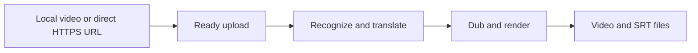

# UnmarkAI Video Translation & AI Dubbing API

[English](README.md) · [简体中文](README.zh-CN.md)

[](https://unmarkai.net/video-translation-api/)
[](examples/translate_video.py)
[](LICENSE)

Translate and dub authorized videos with the UnmarkAI REST API. Choose one target language, then retrieve a localized video and subtitle files.

**[Explore the API](https://unmarkai.net/video-translation-api/) · [Get an API key](https://unmarkai.net/dashboard/api/keys) · [Try the web tool](https://unmarkai.net/video-translation-studio/)**

This repository contains open-source integration examples for a hosted API. It does not contain model weights or a self-hosted processing engine. API usage requires an API key and available API balance; website points and API USD balance are separate.

## From source video to another language



This is a workflow illustration. There is no measured translation demo bundled in this repository. Start with a short video you are authorized to process and review the downloaded result.

## Quickstart: Python

Requires Python 3.10+. Run from the repository root:

```bash
git clone https://github.com/DayBreak-u/unmarkai-video-translation-api.git
cd unmarkai-video-translation-api
python3 -m venv .venv
source .venv/bin/activate
python -m pip install -r requirements.txt
export UNMARKAI_API_KEY='uma_live_replace_with_your_key'
python examples/translate_video.py --file ./source.mp4 --target es
```

The command uploads your video, creates a job, polls it and saves outputs under `output/`. Requests go to `https://api.unmarkai.net/v1` by default; set `UNMARKAI_API_BASE` to override it. A separate mainland China endpoint (`https://unmarkai.cn/api/v1`, separate keys and CNY wallet) is documented in [README.zh-CN.md](README.zh-CN.md). The key is read from the environment; `.env.example` is a template, not automatically loaded. Keep API keys on your server.

**Direct HTTPS import** (a downloadable video URL, not a YouTube/TikTok watch page):

```bash
python examples/translate_video.py --url 'https://your-cdn.example/owned-video.mp4' --target es
```

**Resume an existing job without creating another:**

```bash
python examples/translate_video.py --job-id job_REPLACE --output output
```

**Reuse an upload:**

```bash
python examples/translate_video.py --upload-id upl_REPLACE --target es --idempotency-key your-stable-request-id
```

The example prints upload ID, job ID and the creation idempotency key. Retries of a creation request must use the **same upload ID, options and key**. Re-running `--file` creates a fresh upload, so use `--upload-id` when retrying an uncertain job submission. A client polling timeout does not cancel a server job.

## Translation controls

| CLI option | API field | Behavior |
|---|---|---|
| `--target es` | `target_language` | One target language per job; required for new jobs |
| `--source auto` | `source_language` | Auto-detect source language by default |
| `--advanced` | `advanced_quality` | Use Advanced rather than Standard processing |
| `--no-subtitles` | `subtitle_enabled: false` | Disable burned-in subtitles; retain voiceover |

The Python quickstart exposes the core workflow. The current OpenAPI also documents `tts_enabled`, `voice_strategy`, `voice_key`, `target_locale`, background audio, reference text, subtitle styling/layout and output resolution. Consult the contract for supported combinations and the voice catalog; do not infer API controls from website features. Lip sync is not demonstrated here.

On success, available outputs are saved as `translated.mp4`, `source.srt`, `translated.srt` and optional audio/original-ASR subtitle files.

## REST and cURL

- [Runnable upload and creation example](examples/quickstart.sh) — requires Bash, cURL and jq.
- [Request examples and API workflow](docs/api.md).
- [Canonical OpenAPI contract](https://unmarkai.net/openapi-v1.yaml) — source of truth for fields and limits.

```bash
export UNMARKAI_API_KEY='uma_live_replace_with_your_key'
TARGET_LANGUAGE=es bash examples/quickstart.sh ./source.mp4
```

## Clean subtitles before translation

For burned-in source captions, first run the [video text removal API](https://github.com/DayBreak-u/unmarkai-video-text-removal-api), download the clean result, upload it again and create a translation job. These are **two separate, separately billed jobs**.

[Agent Skills](https://github.com/DayBreak-u/unmarkai-skills) and the [existing MCP guide](https://unmarkai.net/video-text-removal-api/#api-agents-title) cover the cleanup stage. They are linked as companion tools; this repository does not claim a translation MCP tool or translation Skill exists.

## Limits, pricing and reliability

- Up to 2 GiB and 60 minutes per source video; API upload formats include MP4, MOV, AVI, MKV, WebM and MPEG. Runtime validation is authoritative.
- Jobs are asynchronous. Use bounded polling or [signed webhooks](https://unmarkai.net/dashboard/api/docs); the examples use polling.
- Download signed result links promptly. Re-fetch job status if a URL expires, while the result remains retained under the service policy.
- Base rates: Standard translation $0.45/min; Advanced $1.125/min. Billing minimums and rounding follow the current service rules. Account discounts and effective prices come from `GET /v1/balance`; check the [current API pricing](https://unmarkai.net/video-translation-api/#volume-pricing).
- API trial eligibility and funding rules may change; check your console. Website subscription points do not fund API jobs.

## FAQ

**Can I translate one video into several languages?**

Create a separate video_translation job for each target language. Each has its own processing state and charge.

**Does translation erase existing hardcoded subtitles?**

No. Remove approved burned-in captions with a separate cleanup job before translation if needed.

**Is the processing engine open source?**

The example integration code is MIT-licensed. Processing runs on UnmarkAI’s hosted service, with its own pricing and terms.

**What may I upload?**

Only video you own, license or have explicit permission to edit. Keep attribution and required notices. Review output before publishing.

## Developer resources

- [API documentation](https://unmarkai.net/dashboard/api/docs)
- [Create an API key](https://unmarkai.net/dashboard/api/keys) · [API console](https://unmarkai.net/dashboard/api/)
- [OpenAPI contract](https://unmarkai.net/openapi-v1.yaml)
- [Agent Skills](https://github.com/DayBreak-u/unmarkai-skills) · [Text-removal MCP guide](https://unmarkai.net/video-text-removal-api/#api-agents-title)
- [Video text removal API examples](https://github.com/DayBreak-u/unmarkai-video-text-removal-api)
- [Video translation API examples](https://github.com/DayBreak-u/unmarkai-video-translation-api)
- [Contact](https://unmarkai.net/contact/) · [Privacy](https://unmarkai.net/privacy/) · [Acceptable use](https://unmarkai.net/acceptable-use/)

## Development

```bash
python -m unittest discover -s tests -v
bash -n examples/quickstart.sh
```

Tests mock API and media responses; they do not upload files or spend API credit. Report integration bugs through GitHub Issues without posting keys, signed URLs or private media. Service-account and billing questions belong in [support](https://unmarkai.net/contact/).

## License

[MIT](LICENSE) for original example code and documentation. Linked demonstration media, trademarks and the hosted service remain subject to their respective rights and terms.
